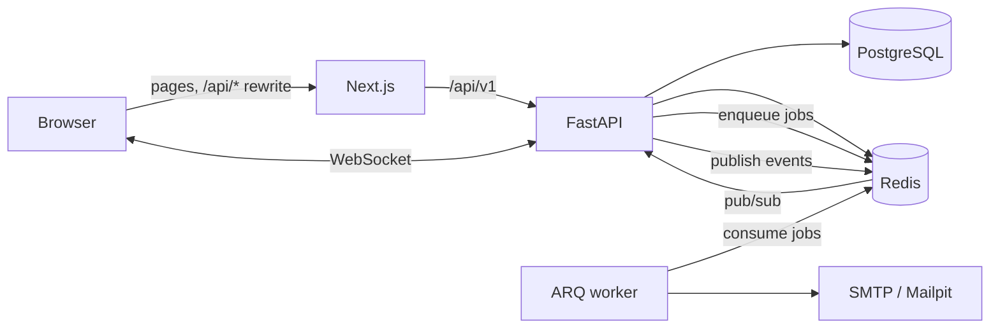

# AutoServis

AutoServis is a web platform that connects car owners with car repair workshops. It covers the full lifecycle of a repair order: booking a slot, vehicle intake, diagnosis, cost estimate and client approval, repair, invoice and payment.

The user interface is in Polish because the target users are Polish clients and workshops. Everything aimed at developers (code, API, documentation, commits) is in English.

> Status: **Stage 3 of 8 completed** — public workshop search, client vehicles, online booking with free slot search, a client appointment list, a daily workshop calendar and workshop administration.

## Features

| Who | What |
| --- | --- |
| Everyone | Search workshops by city and name (`/warsztaty`), see opening hours, upcoming closures and the price list |
| Client | Register, sign in, manage profile and vehicles (`/pojazdy`) with VIN and plate validation |
| Client | Book a visit (`/warsztaty/[slug]/rezerwacja`): pick a service, vehicle, day and free time slot; see upcoming and past visits and cancel them up to 12 hours ahead (`/wizyty`) |
| Mechanic | Daily workshop calendar (`/panel/kalendarz`) with appointments per bay, vehicle check-in and no-show marking; read-only workshop data, opening hours, bays, services and team |
| Manager | Everything a mechanic sees plus cancelling appointments and editing workshop data, opening hours, closures, bays and the price list with a required bay type per service |
| Administrator | Manage users and roles (`/admin/uzytkownicy`), create and deactivate workshops and assign staff (`/admin/warsztaty`) |

## Tech stack

| Area | Technologies |
| --- | --- |
| Frontend | Next.js 16 (App Router, React Server Components, Cache Components), TypeScript, next-intl, TanStack Query, Zustand, Tailwind CSS, shadcn/ui, React Hook Form, Zod, openapi-fetch |
| Backend | Python 3.12, FastAPI, SQLAlchemy 2 (async), Alembic, Pydantic v2, ARQ, structlog |
| Data | PostgreSQL 16, Redis 7, S3 compatible object storage (added in stage 5) |
| Quality | Ruff, mypy (strict), pytest, ESLint, Prettier, Vitest, Testing Library, GitHub Actions |
| Local tooling | Docker Compose, uv, pnpm, Mailpit |

## Getting started

Requirements: Docker Desktop (or Docker Engine with Compose v2) and Git.

```bash
git clone https://github.com/PSkrzyp11/AutoServis.git
cd AutoServis
cp .env.example .env
```

Set `JWT_SECRET_KEY` in `.env` to a random string of at least 32 characters, then start the stack:

```bash
docker compose up --build
```

| Service | URL |
| --- | --- |
| Web application | http://localhost:3000 |
| API documentation (Swagger UI) | http://localhost:8000/docs |
| Readiness probe | http://localhost:8000/health/ready |
| Mailpit (captured emails) | http://localhost:8025 |

Database migrations run automatically through the `migrate` service before the API starts.

Create an administrator account:

```bash
docker compose exec backend python -m app.cli create-admin --email admin@autoservis.pl --full-name "Administrator"
```

Load demo data (two workshops in Warsaw and Kraków, their staff, clients and vehicles):

```bash
docker compose exec backend python -m app.cli seed-demo
```

The command is idempotent and refuses to run when `APP_ENV=production`. All demo accounts use the password from `DEMO_USER_PASSWORD` in `.env`, for example:

| Role | Email |
| --- | --- |
| Manager (Warsaw) | `tomasz.wisniewski@example.com` |
| Mechanic (Warsaw) | `marek.kaminski@example.com` |
| Manager (Kraków) | `katarzyna.lewandowska@example.com` |
| Client | `magdalena.jankowska@example.com` |

Demo content lives in `backend/app/seed/data/pl/demo.json` and is validated with the same schemas as the API.

## Development commands

All tooling runs inside containers, so nothing except Docker has to be installed locally.

### Backend

```bash
docker compose run --rm backend ruff format .
docker compose run --rm backend ruff check .
docker compose run --rm backend mypy app alembic tests
docker compose run --rm backend pytest --cov
docker compose run --rm backend alembic upgrade head
docker compose run --rm backend python -m app.cli export-openapi --output openapi.json
```

### Frontend

```bash
docker compose run --rm --no-deps frontend pnpm lint
docker compose run --rm --no-deps frontend pnpm typecheck
docker compose run --rm --no-deps frontend pnpm test
docker compose run --rm --no-deps frontend pnpm build
```

### API contract

`backend/openapi.json` is the contract between the backend and the frontend. After changing an endpoint or schema:

1. Export the schema with `python -m app.cli export-openapi --output openapi.json` (backend).
2. Regenerate the typed client with `pnpm generate:api` (frontend).

CI fails when either file is out of date.

## Architecture



### Backend layers

```
backend/app
├── api            HTTP routers, versioned under /api/v1, request and response mapping only
├── services       business logic, transactions and authorization rules
├── repositories   database access with SQLAlchemy
├── models         SQLAlchemy models
├── schemas        Pydantic request and response models
├── core           configuration, security, errors, logging, infrastructure clients
├── workers        ARQ background tasks and task queue abstraction
├── ws             WebSocket gateway, connection manager and Redis pub/sub hub
└── templates/pl   Polish email and document templates
```

Routers call services, services call repositories. Business logic never lives in routers.

### Error format

Every error response has the same shape. The frontend maps `code` to a Polish message.

```json
{
  "error": {
    "code": "INVALID_CREDENTIALS",
    "message": "Invalid email or password",
    "details": {}
  }
}
```

Validation errors use the `VALIDATION_ERROR` code and list invalid fields in `details.fields`.

### Authentication

- Sign in returns a short-lived access token (JWT, 15 minutes) that the frontend keeps in memory.
- The refresh token is an opaque random value stored as a SHA-256 hash in the database and sent to the browser as an `HttpOnly`, `SameSite=Lax` cookie scoped to `/api/v1/auth`.
- Every refresh rotates the refresh token. Reusing an already rotated token revokes the whole session family, which protects against stolen tokens.
- Passwords are hashed with Argon2id. Sign in, registration and password reset are rate limited in Redis.
- Next.js rewrites `/api/*` to the backend, so the browser talks to a single origin and no CORS configuration is needed.
- Roles: `CLIENT`, `MECHANIC`, `MANAGER`, `ADMIN`. Endpoints declare required roles through FastAPI dependencies.
- Workshop data is scoped by membership: mechanics and managers only reach workshops they are assigned to, managers can change them, administrators can access all of them.

### Domain rules

- Money is stored as `NUMERIC(12,2)` and handled with `Decimal`. Prices are kept net with a VAT rate (0, 5, 8 or 23 percent) and serialized as strings with two decimal places.
- Opening hours are stored as local wall-clock times in the workshop time zone (`Europe/Warsaw`), with ISO weekdays where 1 is Monday.
- VINs and plate numbers are normalized to upper case without spaces. A VIN is unique among vehicles that are not deleted, so a sold car can be added to a new account.
- Vehicles are soft deleted to keep their service history.

### Bookings

- Free slots are computed every 15 minutes from the weekly opening hours, closure days, the service duration and existing appointments. A slot is free when at least one suitable bay is free for the whole duration. Services can require a bay type, for example a tire bay.
- Clients pick a time, the bay is assigned automatically inside a database savepoint.
- Double booking is impossible at the database level. Two `EXCLUDE USING gist` constraints on a generated `tstzrange` column prevent overlapping active appointments on the same bay and for the same vehicle. A concurrency test books the last free slot from two transactions at once and expects exactly one winner.
- Opening hours are local wall-clock times. Slots are converted to UTC with `zoneinfo`, so daylight saving time changes are handled.
- A confirmation email is sent after booking. An ARQ cron job runs every 15 minutes and sends reminders 24 hours ahead, claiming rows with `FOR UPDATE SKIP LOCKED` so that parallel workers never send the same reminder twice.
- Booking rules are configurable in `.env`: lead time, booking horizon, client cancellation deadline and reminder window.
- The booking page shows the next three weeks with closed days disabled. When someone takes the chosen slot first, the API returns `APPOINTMENT_SLOT_TAKEN` and the page reloads free slots.
- The workshop calendar is a grid with one column per bay and 15 minute rows on larger screens and a list grouped by bay on phones.

### Service orders

- Checking a vehicle in on the workshop calendar opens a service order in status `RECEIVED` in the same transaction. A checked-in appointment can no longer be cancelled; the order is cancelled instead.
- Order statuses follow an explicit transition map in `app/services/order_workflow.py`: `RECEIVED → DIAGNOSIS → WAITING_FOR_APPROVAL → (WAITING_FOR_PARTS →) IN_PROGRESS → READY → COMPLETED`, back from `WAITING_FOR_APPROVAL` to `DIAGNOSIS` after a rejected estimate, and `CANCELLED` from every open status except `READY`. Any other change returns `INVALID_STATUS_TRANSITION`. Asking the client for approval requires a diagnosis.
- Every change is stored in `order_status_history` with the author and an optional note. Clients see the history without internal notes.
- A status change states the status the user saw (`expected_status`). The order row is locked with `SELECT ... FOR UPDATE`, so when two people move the same card at once the second one gets `ORDER_STATUS_CONFLICT` instead of silently overwriting the first change. A test runs both changes in parallel transactions.
- Mechanics see all orders of their workshop but change only orders assigned to them or unassigned ones; moving an unassigned order assigns it to them. Managers can change any order and assign mechanics. Each order in the API lists the transitions the signed in user may perform, so the frontend does not duplicate the rules.
- Clients receive an in-app notification for every status change and an email (Polish template) when the order waits for their approval, is ready for pickup or is cancelled. Mechanics are notified when a manager assigns them an order.

### Realtime updates

- The browser asks `POST /api/v1/realtime/tickets` for a one-time ticket (stored hashed in Redis for 30 seconds) and opens `ws://.../api/v1/realtime/socket?ticket=...`. The access token never appears in a URL, and the `Origin` header is checked against an allow list.
- A ticket lists the channels the user may listen to: their own notification channel and the channels of workshops they work in.
- Services publish small events (`order.changed`, `appointment.changed`, `notification.created`) to Redis only after the database transaction commits, through an outbox collected during the request. Clients react by reloading data through the REST API.
- Every API process subscribes to `realtime:*` in Redis and forwards messages to its own WebSocket connections, so events reach users connected to any process.
### Internationalization

- UI texts live only in `frontend/messages/pl.json` with English keys such as `auth.login.submit`. The structure is ready for additional locales.
- Translation keys are type-checked. Adding a new backend error code without a Polish translation fails the TypeScript build.
- Polish URLs (`/logowanie`, `/konto`) map to English route folders through next-intl pathnames.
- Public pages (`/warsztaty`) are rendered on the server with Partial Prerendering: a static shell is served immediately and workshop data is streamed in, so search engines see the full content.
- Signed-in areas are client-side guarded and fetch data with TanStack Query through the typed API client.
- Dates, numbers and amounts are formatted for `pl-PL` in the `Europe/Warsaw` time zone. All timestamps are stored in UTC.
- Texts generated by the backend for users (emails, documents) use templates in `backend/app/templates/pl`.

## Conventions

- **No comments in code or configuration.** Names, types, enums and small functions explain the code. API documentation comes from FastAPI parameters. `scripts/check_no_comments.py` and an ESLint rule enforce this in CI.
- **English for developers, Polish for users.** Code, commits, logs and API messages are English. UI texts are Polish and go through i18n.
- **Strict typing.** mypy runs in strict mode and TypeScript runs in strict mode with `noUncheckedIndexedAccess`.
- **Conventional Commits** for commit messages and one branch per stage.

## Roadmap

1. ✅ Monorepo foundation, Docker Compose, configuration, health checks, CI, i18n, authentication and RBAC
2. ✅ Workshops, vehicles, service bays and demo seed data
3. ✅ Bookings and calendar with database-level double booking protection
4. 🚧 Repair orders, state machine, Kanban board, WebSockets, notifications (backend done)
5. Cost estimates, inventory, chat with photo attachments
6. PDF invoices, Stripe payments, background emails
7. AI diagnostic assistant and workshop manager dashboard
8. End-to-end tests, UI polish, monitoring and deployment
