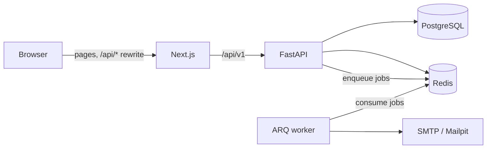

# AutoServis

AutoServis is a web platform that connects car owners with car repair workshops. It covers the full lifecycle of a repair order: booking a slot, vehicle intake, diagnosis, cost estimate and client approval, repair, invoice and payment.

The user interface is in Polish because the target users are Polish clients and workshops. Everything aimed at developers (code, API, documentation, commits) is in English.

> Status: **Stage 1 of 8** — monorepo foundation, infrastructure, internationalization and authentication with role-based access control.

## Tech stack

| Area | Technologies |
| --- | --- |
| Frontend | Next.js 16 (App Router, React Server Components, Cache Components), TypeScript, next-intl, TanStack Query, Zustand, Tailwind CSS, shadcn/ui, React Hook Form, Zod, openapi-fetch |
| Backend | Python 3.12, FastAPI, SQLAlchemy 2 (async), Alembic, Pydantic v2, ARQ, structlog |
| Data | PostgreSQL 16, Redis 7, S3 compatible object storage (added in stage 5) |
| Quality | Ruff, mypy (strict), pytest, ESLint, Prettier, Vitest, Testing Library, GitHub Actions |
| Local tooling | Docker Compose, uv, pnpm, Mailpit |

## Getting started

Requirements: Docker Desktop (or Docker Engine with Compose v2) and Git.

```bash
git clone https://github.com/PSkrzyp11/AutoServis.git
cd AutoServis
cp .env.example .env
```

Set `JWT_SECRET_KEY` in `.env` to a random string of at least 32 characters, then start the stack:

```bash
docker compose up --build
```

| Service | URL |
| --- | --- |
| Web application | http://localhost:3000 |
| API documentation (Swagger UI) | http://localhost:8000/docs |
| Readiness probe | http://localhost:8000/health/ready |
| Mailpit (captured emails) | http://localhost:8025 |

Database migrations run automatically through the `migrate` service before the API starts.

Create an administrator account:

```bash
docker compose exec backend python -m app.cli create-admin --email admin@autoservis.pl --full-name "Administrator"
```

## Development commands

All tooling runs inside containers, so nothing except Docker has to be installed locally.

### Backend

```bash
docker compose run --rm backend ruff format .
docker compose run --rm backend ruff check .
docker compose run --rm backend mypy app alembic tests
docker compose run --rm backend pytest --cov
docker compose run --rm backend alembic upgrade head
docker compose run --rm backend python -m app.cli export-openapi --output openapi.json
```

### Frontend

```bash
docker compose run --rm --no-deps frontend pnpm lint
docker compose run --rm --no-deps frontend pnpm typecheck
docker compose run --rm --no-deps frontend pnpm test
docker compose run --rm --no-deps frontend pnpm build
```

### API contract

`backend/openapi.json` is the contract between the backend and the frontend. After changing an endpoint or schema:

1. Export the schema with `python -m app.cli export-openapi --output openapi.json` (backend).
2. Regenerate the typed client with `pnpm generate:api` (frontend).

CI fails when either file is out of date.

## Architecture



### Backend layers

```
backend/app
├── api            HTTP routers, versioned under /api/v1, request and response mapping only
├── services       business logic, transactions and authorization rules
├── repositories   database access with SQLAlchemy
├── models         SQLAlchemy models
├── schemas        Pydantic request and response models
├── core           configuration, security, errors, logging, infrastructure clients
├── workers        ARQ background tasks and task queue abstraction
└── templates/pl   Polish email and document templates
```

Routers call services, services call repositories. Business logic never lives in routers.

### Error format

Every error response has the same shape. The frontend maps `code` to a Polish message.

```json
{
  "error": {
    "code": "INVALID_CREDENTIALS",
    "message": "Invalid email or password",
    "details": {}
  }
}
```

Validation errors use the `VALIDATION_ERROR` code and list invalid fields in `details.fields`.

### Authentication

- Sign in returns a short-lived access token (JWT, 15 minutes) that the frontend keeps in memory.
- The refresh token is an opaque random value stored as a SHA-256 hash in the database and sent to the browser as an `HttpOnly`, `SameSite=Lax` cookie scoped to `/api/v1/auth`.
- Every refresh rotates the refresh token. Reusing an already rotated token revokes the whole session family, which protects against stolen tokens.
- Passwords are hashed with Argon2id. Sign in, registration and password reset are rate limited in Redis.
- Next.js rewrites `/api/*` to the backend, so the browser talks to a single origin and no CORS configuration is needed.
- Roles: `CLIENT`, `MECHANIC`, `MANAGER`, `ADMIN`. Endpoints declare required roles through FastAPI dependencies.

### Internationalization

- UI texts live only in `frontend/messages/pl.json` with English keys such as `auth.login.submit`. The structure is ready for additional locales.
- Translation keys are type-checked. Adding a new backend error code without a Polish translation fails the TypeScript build.
- Polish URLs (`/logowanie`, `/konto`) map to English route folders through next-intl pathnames.
- Dates, numbers and amounts are formatted for `pl-PL` in the `Europe/Warsaw` time zone. All timestamps are stored in UTC.
- Texts generated by the backend for users (emails, documents) use templates in `backend/app/templates/pl`.

## Conventions

- **No comments in code or configuration.** Names, types, enums and small functions explain the code. API documentation comes from FastAPI parameters. `scripts/check_no_comments.py` and an ESLint rule enforce this in CI.
- **English for developers, Polish for users.** Code, commits, logs and API messages are English. UI texts are Polish and go through i18n.
- **Strict typing.** mypy runs in strict mode and TypeScript runs in strict mode with `noUncheckedIndexedAccess`.
- **Conventional Commits** for commit messages and one branch per stage.

## Roadmap

1. ✅ Monorepo foundation, Docker Compose, configuration, health checks, CI, i18n, authentication and RBAC
2. Workshops, vehicles, service bays and demo seed data
3. Bookings and calendar with database-level double booking protection
4. Repair orders, state machine, Kanban board, WebSockets, notifications
5. Cost estimates, inventory, chat with photo attachments
6. PDF invoices, Stripe payments, background emails
7. AI diagnostic assistant and workshop manager dashboard
8. End-to-end tests, UI polish, monitoring and deployment
